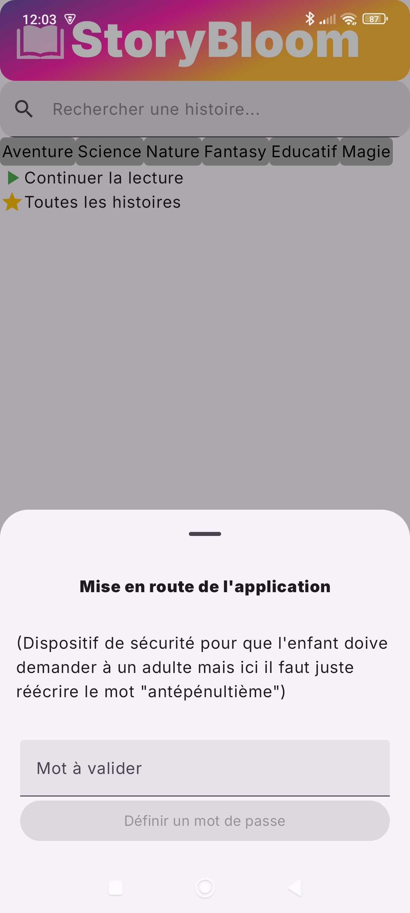
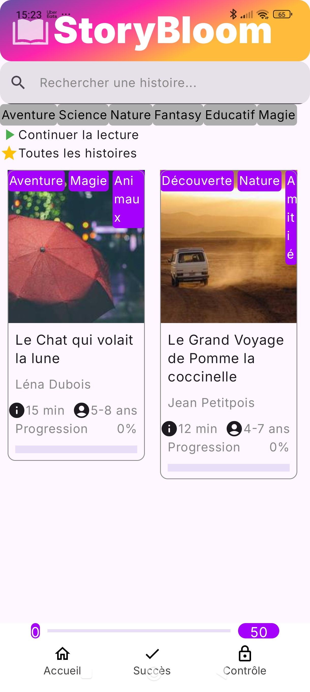
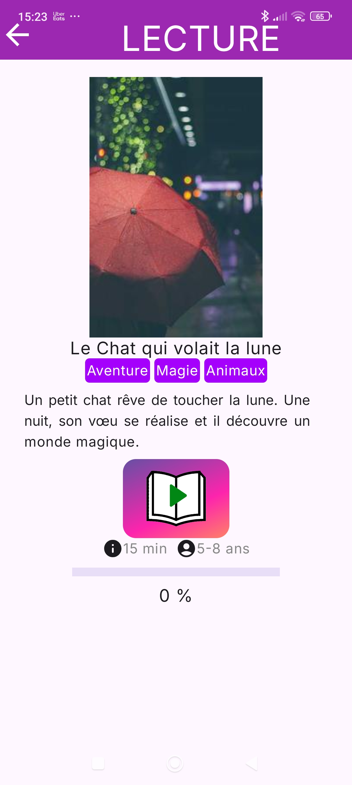
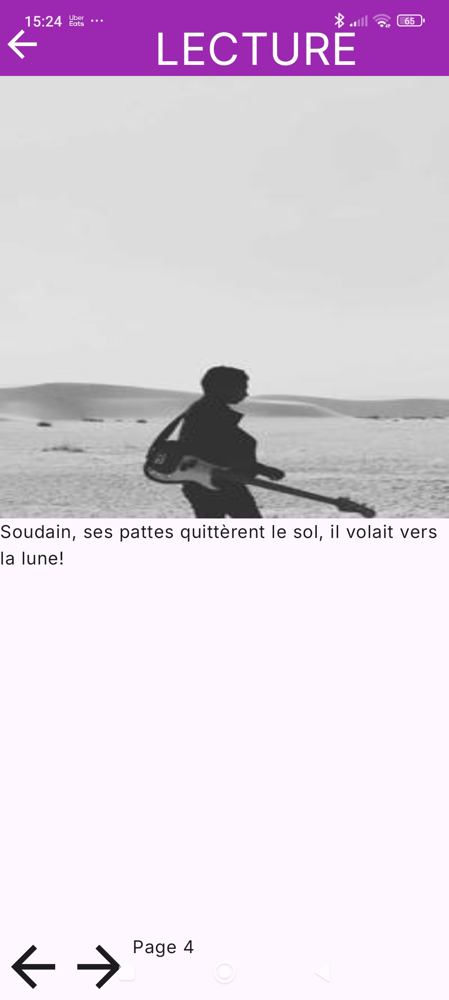
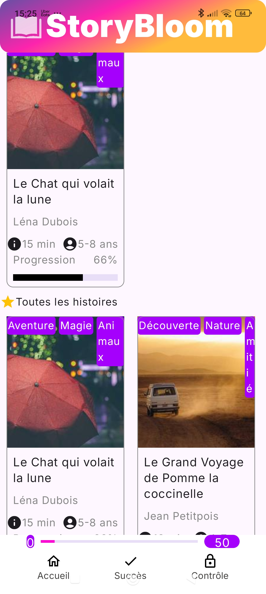
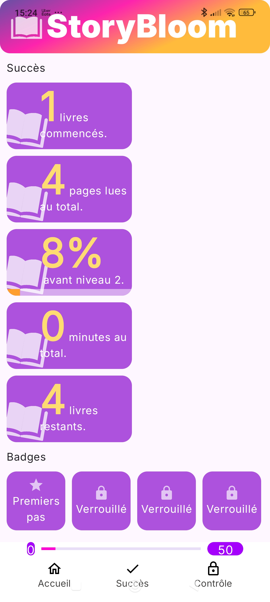

# Projet : Application mobile Story Bloom

Projet Kotlin d'application mobile de lecture interactive pour les enfants

---

## 📝 Présentation

Ce projet est un projet d'etudes dont l'objectif était de concevoir une application mobile delecteure interactive pour inciter les enfants à la lecture.

### ✨Fonctionnalités

- Recherche d'histoires:
  
  - Par barre de recherche
  
  - Par tag

- Lecture de livres:
  
  - Text-To-Speech integré
  
  - Navigation facilité par des fleches
  
  - Image et texte à chaque page
  
  - Sauvegarde de la progression

- Statistiques:
  
  - Progression de lecture des livres
  
  - Nombre de livres commencés et de pages lues
  
  - Système de niveau et de progression de niveau
  
  - Temps de lecture total

- Badges:
  
  - Succès à débloquer en lisant !
  
  - Collection de badges

- Contrôle parental:
  
  - Accès par mot de passe
  
  - Gestion du temps de lecture maximal

---

### 🖼️ Captures d'écran

### 

---

### Stack Technique

* **Langage** : Kotlin
* **Framework/Lib** : Jetpack Compose
* **Outils** : Android Studio

---

## ⚙️ Installation

Suivez ces étapes pour lancer et utiliser l'application Story Bloom

### Prérequis

* **Systeme d'exploitation** : Windows 10,Windows 11

### Étapes d'installation

1. Clonez le dépôt.
2. Afin que l'application puisse trouver les livres, éxécutez run-server.bat.
3. Sur un IDE modifiez l'IP du serveur JSON et compilez l'application APK.
4. Installez l'APK sur un émulateur ou sur un téléphone connecté au même réseau que le serveur.
5. Lancez l'application.
